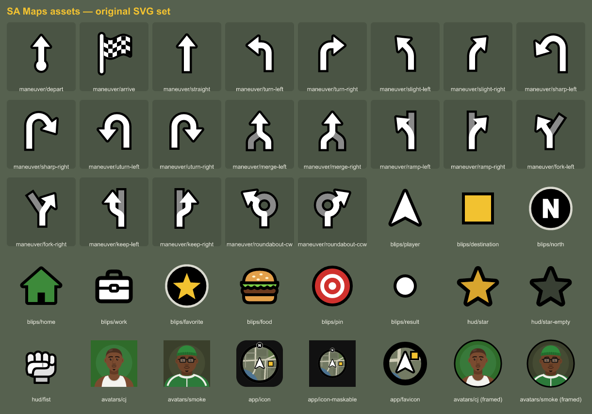

# SA Maps — San Andreas navigation

Turn-by-turn navigation reskinned as the **GTA San Andreas radar & HUD**, with **CJ and Big Smoke**
reading the directions. Works in the browser (installable PWA), as an Android app, and on
**Android Auto**.

> Fan-made parody for a lab project. Not affiliated with or endorsed by Rockstar Games or Take-Two.
> No game assets are included: the map style, icons, avatars, sounds and dialogue are all original,
> and the voices are stock neural TTS voices cast to fit the characters — **not** clones of the actors.



## What it does

- **Full-screen SA radar** (or the classic round minimap, in Options): olive land, navy water, pale flat
  roads, gang-turf tint (Grove green / Ballas purple / Vagos yellow), burger blips on fast food, a player
  arrow, the north badge, and blips that stick to the edge of the screen when they're off it.
- **SA HUD**: clock, the "weapon" slot shows the next turn + distance, health bar = trip progress, armor =
  battery, **$ money = metres left**, **wanted stars when you go off-route**, mission TIME/ETA boxes,
  the black help box with the next instruction, zone names in gothic letters as you enter districts.
- **Missions**: picking a destination opens a *mission briefing*; arriving shows **MISSION PASSED!
  RESPECT +** and adds the distance to your lifetime money; ending early is *MISSION FAILED!*.
- **CJ & Big Smoke**: ~840 original in-character lines + 38 banter exchanges. They alternate turns,
  quip at each other, comment on long straights, and Smoke notices every burger joint you pass.
  Take a wrong turn and Smoke reminds you that *all you had to do was follow the damn train, CJ!*
- **Test drive**: simulates the whole route so you can try it from your desk.
- Works anywhere OpenStreetMap has data (tested in Los Angeles and **Beirut** — non-Latin street names
  are swapped for their Latin names from the map so the voices can read them).

## Pieces

| Folder | What | Runs on |
|---|---|---|
| [`web/`](web) | The app itself (MapLibre + vanilla JS modules, no build step) | GitHub Pages |
| [`tts-server/`](tts-server) | Neural voices (Kokoro-82M, open model) for CJ & Smoke | Your VPS (Docker) |
| [`android/`](android) | Phone app + **Android Auto** (Car App Library, navigation category) | Your phone |

Free, keyless services used: [OpenFreeMap](https://openfreemap.org) tiles, [OSRM](https://project-osrm.org)
routing (FOSSGIS servers), [Photon](https://photon.komoot.io) search — all OpenStreetMap data.
See [ARCHITECTURE.md](ARCHITECTURE.md) for the web ↔ Android bridge.

## 1. Web app (GitHub Pages)

Pushing to `main` deploys `web/` via [`.github/workflows/pages.yml`](.github/workflows/pages.yml)
(repo **Settings → Pages → Source: GitHub Actions**). Open the Pages URL on your phone in Chrome →
menu → **Add to Home screen** to install it.

Run locally with any static server, e.g.:

```bash
npx serve web
```

## 2. Voices (VPS)

Without a voice server the app falls back to your device's text-to-speech. For the natural voices,
deploy [`tts-server/`](tts-server) on a VPS (one command, see its README), then either:

- set the repo variable **`TTS_URL`** (Settings → Secrets and variables → Actions → Variables) to the
  server's https URL and re-run the Pages workflow, or
- paste the URL into **Options → Voice server** in the app.

**Your own clips:** Options → *Wrong-turn / Mission-start / Mission-passed clip* lets you load an audio
file from your phone for those moments. It's stored on the device only and never uploaded.

## 3. Android + Android Auto

Grab `sa-maps-debug.apk` from the **Actions → Build Android APK** run artifacts (or a release if you
push a `v*` tag), install it on your phone, then enable it for Android Auto:

1. Android Auto settings → scroll to **Version** → tap it 10 times → developer mode on.
2. ⋮ menu → **Developer settings** → enable **Unknown sources**.
3. Plug into the car (or use the Desktop Head Unit) — **SA Maps** shows up in the launcher.

On the phone it runs full-screen with native GPS and voices. When Android Auto connects, the car
screen takes over navigation and the phone becomes a remote: pick a place on the phone and it's
sent to the car.

## Options

Crew (both / CJ / Smoke / subtitles only), chatter level (directions only → hood mode), clean
language, units, route colour, full-screen vs classic radar, north-up, street names on radar, gang
turf, your ride's name, voice server, device fallback voices, custom clips, custom OSRM server.

## Credits

Map data © OpenStreetMap contributors · tiles OpenFreeMap / OpenMapTiles · routing OSRM / FOSSGIS ·
search Photon by Komoot · map rendering MapLibre GL JS · voices Kokoro-82M (Apache-2.0).
Fonts: Pirata One & Anton (Google Fonts, OFL). Optional Pricedown font: see [web/fonts](web/fonts).
